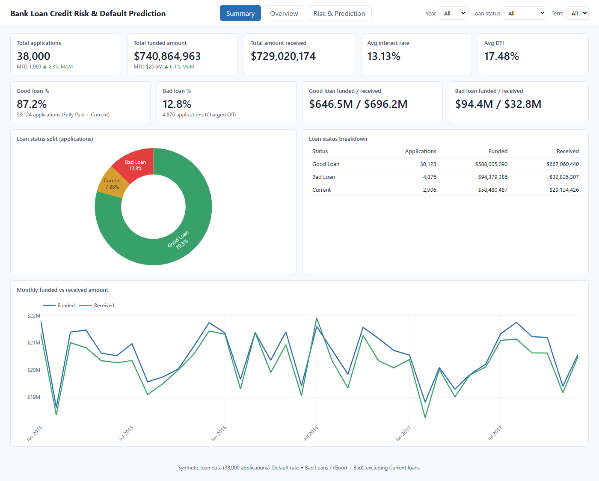
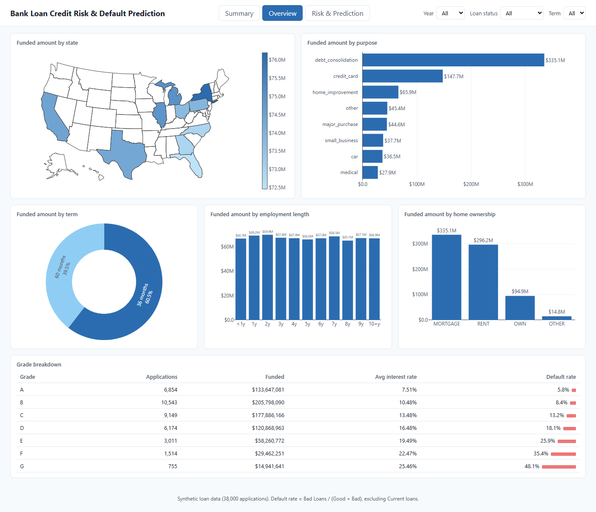
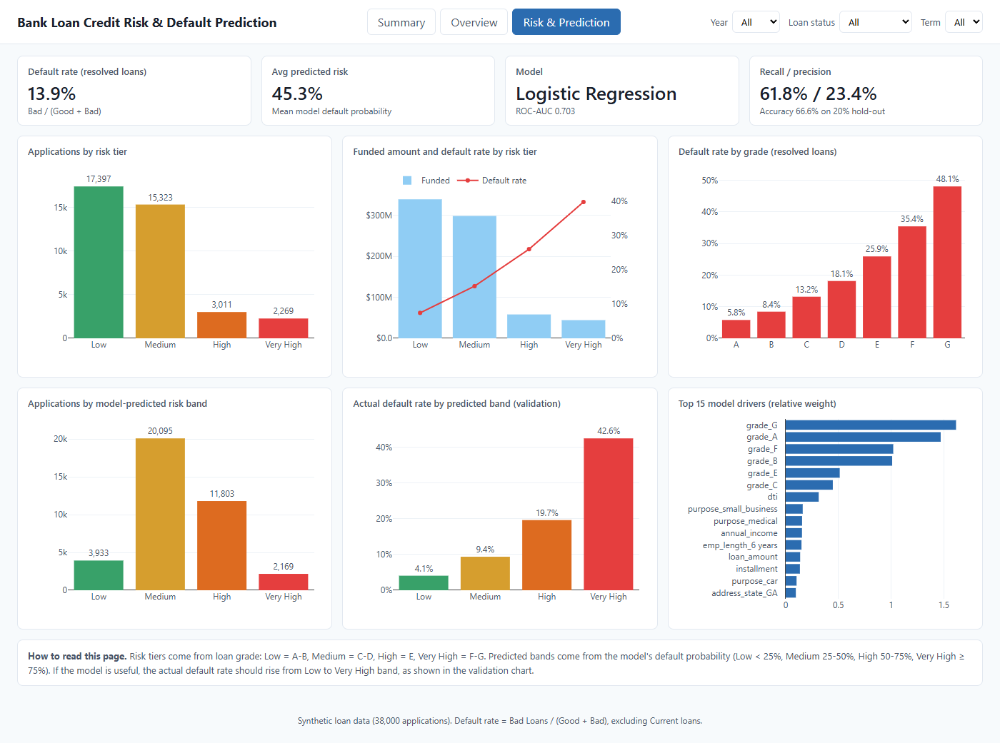

# Bank Loan Credit Risk & Default Prediction

End-to-end data analyst project: assess whether a borrower will repay a loan or default, using historical loan and borrower profile data. It combines **SQL**, **Python**, a **machine-learning model** and a **multi-page interactive dashboard**, using only free tools.

## Key results

| Metric | Value |
|---|---|
| Loan applications analysed | 38,000 |
| Total funded amount | $740.9M |
| Total amount received | $729.0M |
| Bad loans (Charged Off) | 4,876 (12.8%) |
| Default rate on resolved loans | 13.9% |
| Model | Logistic Regression, ROC-AUC **0.703** |
| Defaults caught (recall) | 61.8% |

**Findings**
- Default risk climbs steadily with loan grade, from 5.8% (grade A) to 48.1% (grade G).
- The model separates risk well: actual default rate rises from 4.1% in its Low band to 42.6% in its Very High band.
- Loan grade is the strongest predictor, followed by debt-to-income ratio (DTI) and annual income.

> **Data note:** the dataset is **synthetic** (generated by `src/download_data.py`) with the same schema as the public Kaggle "Bank Loan" dataset, so results demonstrate the method, not real-world lending. To use real data, replace `data/raw/financial_loan.csv` and re-run the pipeline.

## Dashboard

Interactive, with Year / Loan status / Term filters that apply to every page. Run it locally (see below) or open `dashboard/index.html`.

**1. Summary** - applications, funded and received amounts, good vs bad loan split, month-over-month trend


**2. Overview** - breakdowns by state, purpose, term, employment length, home ownership and grade


**3. Risk & Prediction** - risk tiers, default rate by grade, model-predicted risk bands and top model drivers


A Power BI build guide with all DAX measures is in [docs/dashboard_build_guide.md](docs/dashboard_build_guide.md), with a matching theme in [dashboard/theme.json](dashboard/theme.json).

## Tech stack

Python (pandas, scikit-learn, matplotlib) · SQLite · Plotly.js dashboard (HTML/JS) · Playwright (screenshots) · Power BI build guide

## Pipeline

```
download_data.py -> clean.py -> load_db.py -> model.py -> build_dashboard.py
   raw CSV         clean CSV     SQLite DB    scored CSV    dashboard/index.html
```

| Step | Script | Output |
|---|---|---|
| 1. Generate data | `src/download_data.py` | `data/raw/financial_loan.csv` |
| 2. Clean + engineer features | `src/clean.py` | `data/processed/loans_clean.csv` (good/bad status, risk tier, date parts) |
| 3. Load SQL + KPI queries | `src/load_db.py`, `sql/` | `data/loans.db` |
| 4. Train + score model | `src/model.py` | `loans_scored.csv`, feature importances, metrics |
| 5. Build dashboard | `src/build_dashboard.py` | `dashboard/index.html` |
| 6. Screenshots (optional) | `src/screenshot_dashboard.py` | `dashboard/page*.png` |

### Modelling notes
- **Target:** `is_default` (Charged Off = 1, Fully Paid = 0). "Current" loans have no outcome yet, so they are scored but not used for training.
- **Class imbalance:** only 13.9% of loans default, so accuracy is misleading. Models use balanced class weights and are judged on ROC-AUC and recall.
- **No leakage:** `total_payment` is excluded from features because it is only known after the outcome.
- **Compared:** Logistic Regression (ROC-AUC 0.703) vs Random Forest (0.701); the simpler, more interpretable model won.

## Run it yourself

```bash
python -m venv .venv
.venv/Scripts/activate          # Windows (use source .venv/bin/activate on Mac/Linux)
pip install -r requirements.txt

python src/download_data.py
python src/clean.py
python src/load_db.py
python src/model.py
python src/build_dashboard.py

cd dashboard && python -m http.server 8000   # then open http://localhost:8000/index.html
```

## Project structure

```
data/raw/            generated raw dataset
data/processed/      cleaned + scored data, model metrics
data/loans.db        SQLite database
sql/                 schema.sql, kpi_queries.sql
src/                 pipeline scripts + dashboard template
dashboard/           index.html, screenshots, Power BI theme
docs/                design spec, Power BI build guide
LICENSE              MIT
```

## License

Released under the [MIT License](LICENSE).
